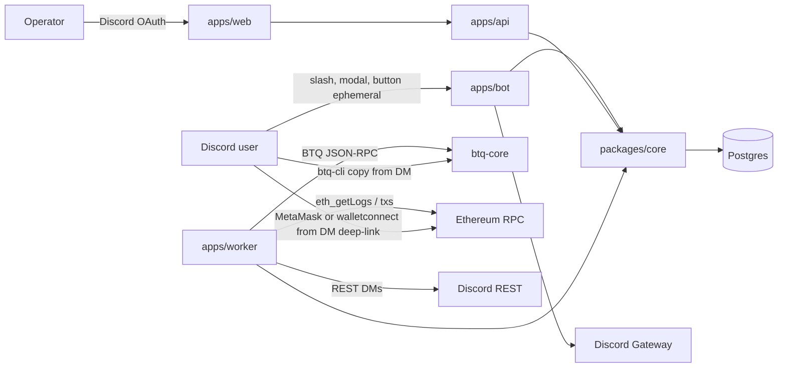

# BTQ Swap: Production Design

Status: draft 2026-11-04. Owner: BTQ operators. Repo: https://github.com/btq-ag/btq-swap

BTQ Swap is a **Discord-first P2P atomic swap venue** for **BTQ ⇄ EVM** (USDT on Ethereum, later other ERC-20s). Users complete the entire lifecycle — register, link wallets, post or take orders, fund HTLCs, claim, refund — with slash commands and private Discord DMs. The operator (you) controls **market-making inventory** on a dedicated order book from an admin web console. The existing React UI remains a secondary client of the same core; Discord is the production buyer terminal.

This document is the master design. Component specs live under [components/](components/). Linear epic: project **BTQ Swap** on team **BTQ**.

## Locked decisions

1. **Discord is the buyer product.** Same shape as Cash for Hash (`/home/o/BTQ/cash-for-hash`): ephemeral slash commands, wallets only in modals, ToS before use, channel redact, worker-only DMs.
2. **Web is the operator console.** Mutating admin (post/pause/reprice MM orders, ban, refund, pause book) is web-only. Discord admin commands are **read-only**.
3. **Settlement model is P2P HTLC, not platform custody.** Matcher is source of truth. `partyB` on EVM = counterparty ETH. Buyer secret is never stored server-side in plaintext. Platform Dilithium/ETH keys are used only for **operator MM orders** (you are a maker like any other, with privileged inventory tools).
4. **One HTLC ABI:** the deployed `HtlcERC20` (`createHTLCProposal` / `withdrawTokens` / `refundTokens` / `getHTLCInstance`). Delete fictional `createSwapERC20` backend ABI and unused frontend `newContract` ABI.
5. **Identity key is Discord snowflake.** ETH + Dilithium + BTQ address are linked attributes, proven by SIWE (ETH) and a signed challenge (Dilithium) — never slash-option text.
6. **Reuse, do not rewrite:** `matching.service`, `order.service` funding verification, `scriptBuilder.service`, contract tests, Docker migrate-on-start. Rewrite workers and `swap.service` against the real ABI and the P2P path.
7. **No private keys in git or compose defaults.** Production secrets from a secret manager. Staging may use a dedicated hot wallet with a hard cap.
8. **v1 chain:** Ethereum mainnet USDT + BTQ mainnet. Staging: Sepolia mock USDT + BTQ testnet/regtest.

## What exists today (gap snapshot)

The repo is a **working demo**, not a production swap.

| Area | Today | Production need |
|---|---|---|
| Buyer UX | React + MetaMask SIWE | Discord `/swap` end-to-end (CFH pattern) |
| Identity | `users.eth_address` only | `discord_id` unique + ToS + ban + linked wallets |
| Order book | CLOB matcher + TradePage | Same book, Discord `book`/`take`/`mine` + **operator MM desk** |
| Settlement | Two products: P2P UI vs platform-MM workers | One P2P machine; MM = operator as maker |
| EVM ABI | Three incompatible ABIs | Single `HtlcERC20` |
| Buy lock | `partyB` = contract; secret discarded | `partyB` = seller; secret stays with buyer |
| Notifications | Socket.IO only | Transactional outbox → Discord DMs |
| Ops | Compose, no CI/TLS/backups | HTTPS, CI, backups, metrics, runbooks |
| Legal | None | ToS accept in `/swap start` |

Detailed audit: see [production-gaps.md](production-gaps.md).

## System context

Buyers never need the Vite app. They get `btq-cli` command blocks in ephemeral replies / DMs (already generated by `scriptBuilder.service`) and an EVM claim/refund payload they can execute from a one-shot wallet connect link or a raw calldata snippet.

## Component index

- [S01 Repository layout and CFH port split](components/S01-repository-layout.md)
- [S02 Identity, ToS, Discord linking](components/S02-identity.md)
- [S03 Discord bot](components/S03-discord-bot.md)
- [S04 Operator order book and market making](components/S04-operator-order-book.md)
- [S05 HTLC settlement (P2P)](components/S05-htlc-settlement.md)
- [S06 Notifications outbox](components/S06-notifications.md)
- [S07 Security, secrets, threat model](components/S07-security.md)
- [S08 Production ops](components/S08-production-ops.md)
- [S09 Testing and delivery phases](components/S09-testing-and-phases.md)

## Target Discord command surface

Buyer root `/swap` (all ephemeral):

| Command | Purpose |
|---|---|
| `start` | ToS + Accept button. Creates user on accept. |
| `link-evm` | Modal → SIWE message the user signs in wallet; bot verifies. |
| `link-btq` | Modal: BTQ address + Dilithium pubkey; worker issues a challenge the user signs with `btq-cli`. |
| `book` | Paginated public book (price, size, side). No addresses. |
| `sell` / `buy` | Modal: amount, price (or market). Creates a **user** order; funding instructions next. |
| `take <id>` | Take a displayed order; modal for receive addresses if not linked. |
| `fund` | Funding status + `btq-cli` / EVM calldata for the actor's open order. |
| `mine` | Actor's open / filled / expired orders. |
| `order <id>` | Detail iff actor is maker or taker. |
| `cancel` | Cancel **their** unfilled order (does not refund an already-locked HTLC — that is `refund`). |
| `claim` | Claim instructions once the counterparty lock is confirmed. |
| `refund` | Refund instructions after timeout. |
| `notifications on\|off` | DM opt-out. |
| `help` | Command list + support channel. |

Admin root `/swap-admin` (read-only, `admin_users` viewer+):

| Command | Purpose |
|---|---|
| `book status` | Spread, inventory, open MM orders, paused flag. |
| `lookup user:<@user>` | Buyer summary; actor is the admin, not the target. |

Mutating MM (`post`, `pause`, `reprice`, `kill`, `ban`) is **admin web only**.

## Delivery phases

**P0 — Make Discord the product (no real funds).** Identity, `/swap start|help|book|mine`, channel guard, outbox stub, admin `lookup`. Book can be seeded.

**P1 — Real P2P settlement.** Unify ABI, fix `partyB` + secret handling, persist `agreementId`, finish claim/refund, Discord `buy|sell|take|fund|claim|refund`.

**P2 — Operator MM desk.** Web console to post/pause/reprice platform orders against the same matcher; inventory + risk caps; you control the book.

**P3 — Production harden.** TLS, CI, backups, metrics, secret manager, confirmations, ToS legal text, mainnet addresses, runbooks.

Out of scope for v1: KYC vendor, mobile app, non-USDT ERC-20s, lightning, custodial balance accounts, Discord mutating admin.
